  

I'm Naga Shreeshyl. I build voice agents, automation workflows, and full-stack products. I'm a BCA (AI & ML) student at Dayananda Sagar College in Bengaluru, and an agentic AI intern at Yellow Metal, a financial services company, where I design and ship production voice agents.

**Voice agents at Yellow Metal.** I build outbound calling agents that combine speech-to-text, text-to-speech, and LLM reasoning, connected to workflow tools so that a call turns into a follow-up without manual effort. I care most about making these systems hold up in Indian languages and on real phone lines.

**AI automation for Indian SMEs.** With a sales co-founder, I'm building voice-agent and workflow-automation services for small and mid-sized businesses.

**Yogstra.** A yoga platform I'm building as a founder, currently pre-launch. It brings teachers, academies, competitions, and live classes into one product, and I handle product, design, and engineering.

**[Yogstra](https://github.com/Nagashreeshyl/Yogstra)** is the full platform behind the yoga ecosystem: teacher discovery and enrollment, academy tools, competitions, and live video classes. Built with React 19, Vite, Tailwind CSS 4, Supabase, Razorpay (including Route for teacher payouts), and LiveKit, deployed on Vercel, with Playwright end-to-end tests.

**[DSCASC Election](https://github.com/Nagashreeshyl/DSCASC-Election)** is an institutional Class Representative election platform that supports any number of independent elections. Voting is enforced by Firestore security rules, so each voter can create exactly one immutable vote document, which rules out double voting across tabs and refreshes. Results combine student votes with weighted authority votes, and ties are flagged rather than broken at random. Built with Next.js, TypeScript, Firebase, and Cloudinary signed uploads.

**[Code Port](https://github.com/Nagashreeshyl/code-port)** turns a guided AI interview into a live resume preview, a downloadable server-generated PDF, and an animated 3D portfolio website. Built with Next.js, React Three Fiber, Framer Motion, the Groq API, and Supabase.

**[Pow Protocol](https://github.com/Nagashreeshyl/Pow-Protocol)** is a neumorphic proof-of-work verification interface, [live on Vercel](https://powprotocol.vercel.app/).

**[Quintyx](https://github.com/Nagashreeshyl/Quintyx)** is the website for a systematic quantitative investing firm, with an admin dashboard and the standard investor and risk-disclosure pages.

**[QR Code Generator](https://github.com/Nagashreeshyl/dsiqrcodegenerator)** is a small TypeScript utility for generating QR codes.

**Gym Tracker** is a personal web app for logging sets and reps on a 6-day split, with AI-generated progression suggestions.

TypeScript, JavaScript, Python, React, Next.js, Vite, Tailwind CSS, Supabase, Firebase, Razorpay, LiveKit, Groq, Playwright, Vercel, Zapier, Dograh, and Sarvam for Indic speech.

I'm open to remote AI and automation work, and happy to talk with anyone building in the voice or agentic space.

[linkedin.com/in/nagashreeshyl](https://www.linkedin.com/in/nagashreeshyl) · [nagashreeshyl@gmail.com](mailto:nagashreeshyl@gmail.com)
